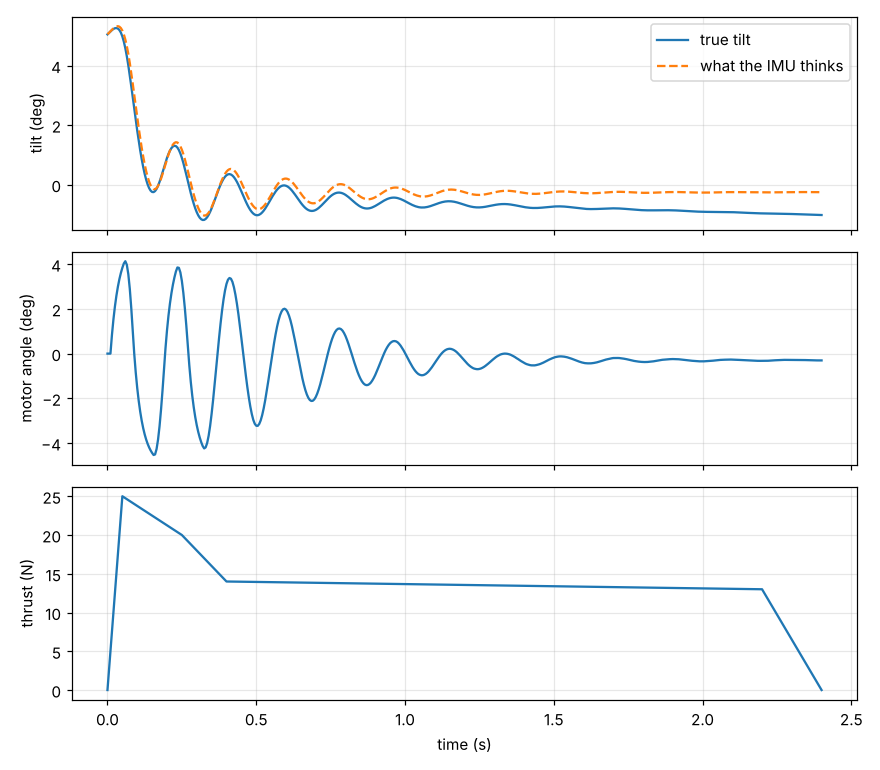

# TVC rocket

A model rocket that keeps itself upright by steering its motor, the way real orbital rockets do. It uses an ESP32 flight computer, an MPU6050 gyro and two micro servos on a 3D-printed gimbal.



## How it works

The motor sits at the bottom, so the rocket behaves like a broom balanced on your palm. Left alone, a small lean grows faster and faster. To stop that, the flight computer swings the motor a few degrees so the thrust pushes the tail back under the nose. If the nose leans right, the nozzle swings left, the exhaust pushes the tail right, and the nose comes back.

Nobody can react that fast by hand, so the flight computer runs the loop 200 times a second. The IMU measures how far the rocket is tilted and how fast the tilt is changing. The computer turns that into a motor angle with this rule:

```
δ = Kp·θ + Kd·ω + Ki·∫θ
```

θ is the tilt, ω is how fast it's tilting, and δ is how far the motor swings. Kp pushes harder the more the rocket leans. Kd works like a brake so the correction doesn't overshoot. The small Ki term cancels a steady push, such as a motor mounted a little crooked. Then two servos swing the motor in pitch and yaw.

The rocket doesn't land on its engine like a Falcon 9. A small solid motor can't throttle or relight, so it comes down on a parachute fired by the motor's ejection charge.

## What's in here

```
cad/gimbal.py          generates the gimbal parts (change sizes at the top)
cad/stl/               ready-to-print STL files
firmware/tvc_flight/   ESP32 flight computer (Arduino)
sim/tvc_sim.py         pitch simulation for tuning gains
docs/assembly.md       printing, gimbal, servos, wiring, motor
docs/safety-checklist.md
docs/design-review.md  what changed after the design was attacked
```

## Parts

All of this comes to roughly $70 to $115, not counting the 3D printer. Prices are approximate and vary by seller.

| Part | Spec | Approx. cost (USD) |
|---|---|---|
| Flight computer | ESP32 dev board (a Teensy 4.0 also works, with code changes) | 8 |
| IMU | MPU6050 breakout board (GY-521) | 3 to 5 |
| Servos (2) | MG90S metal-gear 9 g micro servos | 8 to 10 |
| Power | 2S LiPo, 300 to 500 mAh, plus a 5 V 3 A BEC and a 470 µF capacitor | 12 to 20 |
| Gimbal parts | The STL files in `cad/stl`, printed in PETG or ASA | 3 to 5 |
| Hardware | M3 bolts, 1.5 mm steel wire pushrods, M2 servo screws | 5 to 8 |
| Motor | Certified 24 mm solid motor, average thrust at least 3 × rocket weight | 15 to 30 |
| Recovery | Parachute and wadding | 15 to 25 |
| Safety | Arming switch, status LED, buzzer | 3 |
| Airframe | Body tube, 65 mm inside diameter (or change `body_id` in `gimbal.py`) | varies |

Pick the motor from the maker's data sheet and follow your country's rocketry rules (NAR or Tripoli in the US). Never modify a motor.

## Gimbal parts

| File | What it does |
|---|---|
| `motor_sleeve.stl` | Holds the motor. A lip at the front takes the thrust and lets the ejection gas through. Tilts about X. |
| `inner_ring.stl` | Carries the sleeve and tilts about Y. |
| `outer_mount.stl` | Glued into the body tube. Holds the ring. |
| `servo_plate.stl` | Holds both servos above the gimbal. |

The parts clear each other across ±8° on both axes. The firmware stops at 5°.

## Getting started

1. Tune in the sim first. Put your rocket's mass, pivot-to-CG distance and motor thrust curve into `sim/tvc_sim.py`, then run:
   ```
   pip install -r sim/requirements.txt
   python sim/tvc_sim.py --sweep
   python sim/tvc_sim.py
   ```
2. Print and build the gimbal by following `docs/assembly.md`.
3. Flash the firmware. In the Arduino IDE, install the ESP32 board package and the ESP32Servo library, open `firmware/tvc_flight/tvc_flight.ino`, copy your gains into `config.h` and upload.
4. Bench test with no motor. Open the serial monitor at 115200, send `b`, tilt the rocket by hand and make sure the nozzle swings the right way on both axes. Wrong servo direction is the most common way these rockets crash.
5. Fly, using `docs/safety-checklist.md`. After landing, send `d` to get the flight log as CSV.

## Flight sequence

The flight computer never lights the motor. You launch with a normal model rocket launch controller.

| State | What happens |
|---|---|
| DISARMED | Arm switch open. Serial commands work. |
| CALIBRATING | Arm switch closed. Measures gyro bias over 2 s and starts over if the rocket moves. |
| ARMED | Watches for liftoff (over 2.5 g for 20 ms). |
| POWERED | Steers the motor. Tilt comes from the gyro only, because the accelerometer reads thrust in flight. |
| COAST | Burnout detected. Motor centered and logging continues. |
| ABORTED | Tilt passed 30°. Stops steering and centers the motor. |

## License

MIT
