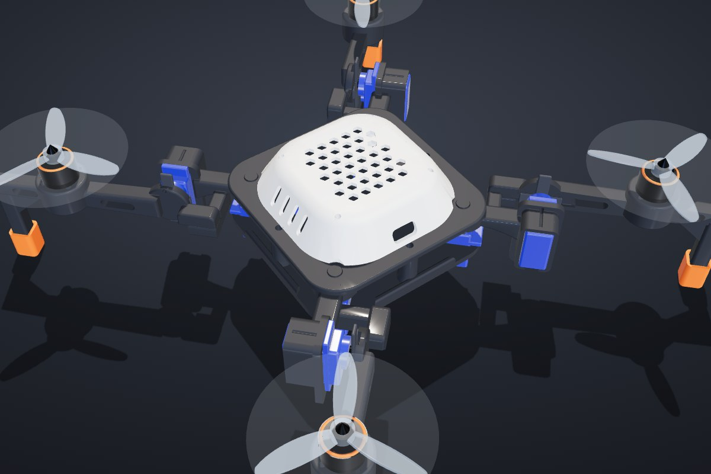

# SkyCrawler

A 3D-printed quadruped robot that walks on four legs and then folds its legs out flat to fly as a quadcopter. You control it from an Android app over WiFi.


<p align="center"></p>

**What's in this repo**

| Folder | What it is |
|---|---|
| [`stl/`](stl) | Print-ready STL and STEP files, already oriented flat on the bed. Open **`stl/parts.html`** for a 3D preview of every part with its print settings |
| [`cad/skycrawler.py`](cad/skycrawler.py) | The parametric CadQuery source. Change a number and every part regenerates |
| [`firmware/`](firmware) | ESP32-S3 code (PlatformIO) for walking, WiFi and flight control |
| [`app/`](app) | Android app (Kotlin) with twin joysticks, walk tricks, hold-to-arm and calibration |
| [`docs/viewer/`](docs/viewer) | A 3D viewer in the browser that lets you scrub between walk and fly, with spinning props |
| [`release/`](release) | Ready-made **`SkyCrawler-1.0.0.apk`**, the firmware **`skycrawler-esp32s3-full.bin`** and **`SkyCrawler-stl.zip`** (all STLs + `parts.html`). Tagging `v*` also makes CI publish them as a GitHub Release |

> ⚠️ **Status: designed, not yet built.** The CAD has been checked in software for collisions across the full joint range. The firmware compiles and the APK builds. Nothing has been printed or flown yet. Fits are based on nominal MG90S dimensions, so expect to adjust tolerances once (see [Tuning the fit](#tuning-the-fit)). Please open an issue with what you find.

---

## How it transforms

Each leg has two servos:

- **Hip (yaw):** swings the leg forward and back.
- **Knee (pitch):** raises and lowers the lower leg. The motor sits on the lower leg.

| | Knee angle | What the lower leg does |
|---|---|---|
| **Walking** | about 90° | Points down. The toe is the foot |
| **Flying** | 0° | Level. It rests on a hard **end stop** and becomes a drone arm. The toe now points down and works as landing gear |

To switch to flying, the robot sits down, lowers each arm onto its stop and **switches the knee servos off**. From then on, propeller thrust pushes the arm *into* the stop. A magnet pair holds it there when the props are idle. The servos carry no load in flight, so they don't buzz, heat up or wobble.

## What's better than the robot in the video

| Problem | SkyCrawler fix |
|---|---|
| The hip servo's output shaft carries the whole arm (thrust, crashes, bending) | **Dual-support hip:** a Ø6 mm pin on top of each upper leg turns in a bushing in the deck plate, so bending loads go into the body instead of the servo gears |
| Arms flop or vibrate in flight | **Positive end stop**, plus a **6×3 mm magnet** to hold the arm and an **M3 levelling screw** to set each arm exactly level |
| The battery hangs below the feet, so landings smash it | The **42 mm toe** clears the belly battery in drone mode. A **TPU boot** grips when walking and cushions landings |
| Flight is either bolted-on or homemade | A real **Betaflight** flight controller does the stabilizing. The ESP32 talks to it as a CRSF receiver, so you get angle mode, auto-level, failsafe auto-land and a voltage readout |
| Only one motor size fits | **Slotted M2 motor mount** fits 9 mm-circle, 9×9 and 12×12 patterns, so any 1103–1404 motor fits |
| Wiring on show | A low one-piece **canopy** with hex vents on top and slotted side vents covers the electronics. The ESP32's USB-C port stays reachable through the front |
| Blocky, printed-looking parts | Tapered, filleted legs, a sleeve that wraps each knee servo, and a gusseted toe. The legs are 10 mm shorter, for a more compact stance |

---

## Parts list (BOM)

**[`docs/SkyCrawler_parts_and_links.xlsx`](docs/SkyCrawler_parts_and_links.xlsx)** has every part with a buy link, price, a cheaper option where there is one, and a "Got it" column that keeps a running "still to buy" total. A second tab lists every printed part, each linked to its 3D preview on GitHub.

The main parts (prices checked Nov 2026, USD):

| Qty | Part | ~$ |
|---|---|---|
| 8 (10-pack) | **MG90S** metal-gear micro servo | 22 |
| 1 (3-pack) | **ESP32-S3 SuperMini**, 4 MB | 19 |
| 1 | **BETAFPV F4 2-3S 20A AIO** flight controller + ESC (26×26 mount; the deck also takes 20×20) | 55 |
| 4 | **T-Motor F1204 5000 KV** motor (the slotted mount fits any 1103–1404 pattern) | 64 |
| 2 packs | **Gemfan 2520 tri-blade 2.5"** props, 1.5 mm | 10 |
| 2 | **GNB 3S 450 mAh** LiPo, XT30 | 30 |
| 1 | **Matek BEC12S-Pro 5 A** regulator: powers the servos and the ESP32. Do **not** use the FC's 5 V for the servos | 19 |
| — | Magnets (6×3 mm, 8 needed), M2/M3 screws and inserts, wire, XT30s, strap, buzzer, resistors | ≈ 80 |
| — | PETG (~90 g) and TPU (~4 g) | — |

All of it comes to **≈ $380** without tools, and **≈ $500** with a LiPo charger, adapter, safe bag and soldering iron. Several items come in packs, so you'll have spares.

Estimated flying weight is about **300 g** with a 3S 450 (the eight servos alone are about 107 g). With four F1204 5000 KV motors on 2.5" props and 3S, expect a thrust-to-weight ratio of about **2:1**. That is plenty for gentle flying. With 1104 motors on 2S it's about 1.4:1, which is only just flyable.

---

## Printing

All files in `stl/` are already oriented flat.

| Part | Qty | Material | Settings |
|---|---|---|---|
| `chassis_bottom` | 1 | PETG/ASA | 3 walls, 30 % gyroid, no supports |
| `chassis_deck` | 1 | PETG/ASA | 3 walls, 30 %, no supports |
| `canopy` (body shell) | 1 | PETG/PLA, white or any colour | 2 walls, 10 %. Print upright on its base with tree supports under the roof |
| `coxa` (upper leg) | 4 | PETG/ASA | **4 walls, 40 %**, supports for the knee-servo frame and the stop ledge |
| `shin_arm` (lower leg / drone arm) | 4 | PETG/ASA | **4 walls, 40 %**. The file is already upside down (motor seat on the bed, toe up); tree supports under the arm and tail |
| `foot_tpu` | 4 | TPU 95A | 2 walls, 20 % |
| `leg_spacer` | 0–4 | any | Only if your horns sit low (see below) |

PLA works for a walking-only test. For flying, use PETG or ASA, because PLA arms crack on the first hard landing.

## Wiring

```
3S LiPo ──XT30──┬── FC (AIO) ── 4 motors
                ├── 5 V 5 A UBEC ──┬── 8 servos (V+ / GND)
                │                  └── ESP32-S3 5V pin
                └── 100k ──┬── 22k ── GND
                         GPIO1 (battery sense, backup to FC telemetry)
```

| ESP32-S3 pin | Goes to |
|---|---|
| GPIO 2 / 3 / 4 / 5 | Hip servo signal: front-right, front-left, back-left, back-right |
| GPIO 6 / 7 / 8 / 9 | Knee servo signal (same leg order) |
| GPIO 12 | Buzzer + |
| GPIO 43 (TX) | FC **RX** pad of the UART you set to Serial RX |
| GPIO 44 (RX) | FC **TX** pad of the same UART (telemetry) |
| GPIO 1 | Battery divider midpoint |
| GND | **Common ground with the FC and the UBEC (required)** |

Pins can be changed in [`firmware/src/config.h`](firmware/src/config.h).

## Assembly

See **[docs/assembly.md](docs/assembly.md)**. In short:

1. Centre all servos.
2. Fit the hip servos into the bottom plate.
3. Fit the upper legs onto the horns, with the pins up through the deck.
4. Fit the knee servos, then the lower legs.
5. Fit the magnets.
6. Fit the electronics.
7. Calibrate in the app.
8. Level the arms with the M3 screws.

## Flight controller setup

See **[docs/betaflight.md](docs/betaflight.md)**. It covers the exact CLI commands: CRSF on a UART, the AUX1 arm / AUX2 angle / AUX3 beeper modes, failsafe auto-land, DShot, and motor order and direction.

## Flashing the firmware

**Easiest:** download [`release/skycrawler-esp32s3-full.bin`](release/skycrawler-esp32s3-full.bin). Then either:

- open <https://espressif.github.io/esptool-js/> in Chrome, connect, and flash it at offset **0x0**, or
- run:
  ```
  esptool.py --chip esp32s3 write_flash 0x0 skycrawler-esp32s3-full.bin
  ```

**From source:**
```
cd firmware
pio run -t upload
```

Change `AP_PASS` in `config.h` before you build.

## The app

Install [`release/SkyCrawler-1.0.0.apk`](release/SkyCrawler-1.0.0.apk) on the phone. Android 8 or newer is required, and you need to allow "install unknown apps". To build it yourself:

```
cd app
./gradlew assembleRelease
```

The APK lands in `app/build/outputs/apk/release/`. To sign it with your own key, set the `SKY_KEYSTORE`, `SKY_KEYSTORE_PASSWORD`, `SKY_KEY_ALIAS` and `SKY_KEY_PASSWORD` environment variables.

1. Power the robot. It beeps twice and starts a WiFi network called `SkyCrawler-XXXX`.
2. Tap **Connect**. Android asks to join the robot's WiFi; the default password is `skycrawler`.
3. **Walk panel:**
   - The left stick walks and turns.
   - The right stick tilts and raises the body.
   - Other controls: Stand, Sit, creep/trot gait, Wave, Dance, Bow.
4. **Transform → drone:** the robot sits, lays its arms on the stops and relaxes the knees. The fly panel appears.
5. **Fly panel:**
   - Left stick is throttle and yaw (throttle doesn't spring back).
   - Right stick is pitch and roll.
   - **Hold ARM for 1 s** to arm. The robot refuses to arm unless it has finished transforming into fly mode, the throttle is low and the battery is OK.
6. **⚙ Settings:** per-servo trims (saved on the robot), *Centre all servos* for assembly, and *Relax*.

### Safety built into the firmware

- If WiFi drops while armed, the ESP32 stops sending CRSF frames and Betaflight's failsafe **auto-lands**.
- You can't switch to walking while armed.
- The knees are switched off in flight, so a servo glitch can't move an arm.
- The battery-low check blocks arming. The app shows the battery voltage.

Read [docs/safety.md](docs/safety.md) before the first flight. **Always take the props off** for setup and calibration.

## Tuning the fit

Everything is in `cad/skycrawler.py`. Install CadQuery and regenerate:

```
pip install cadquery
python cad/skycrawler.py
```

The output goes to `stl/` and `docs/viewer/assembly/`.

| If… | Change |
|---|---|
| Servos are too tight or loose in their slots | `SERVO['L']`, `SERVO['W']` (+0.2 mm per step) |
| The horn doesn't sit flush in the leg's pocket | Print `leg_spacer`, or edit the horn pocket in `coxa()` / `shin()` |
| You use a different motor | `MOTOR_SLOT` (the slots already fit 1103–1404 patterns), `SHIN_TO_MOTOR` (prop clearance) |
| You want longer legs or a taller stance | `SHIN_LEN`, `TOE_LEN`, `COXA_LEN` |
| Your FC uses another mount | `FC_PATTERNS` (20×20 and 26×26 are built in) |

The 3D viewer (`docs/viewer/index.html`) needs to be served, not opened as a file:

```
python -m http.server
```

Then open `localhost:8000/docs/viewer/`.

## How the code is laid out

```
firmware/src/
  main.cpp     mode machine: SIT, STAND, TO_FLY, FLY, TO_WALK, TRICK; arming interlocks; telemetry
  servos.cpp   rate-limited servo targets, trims in flash, relaxing the knees
  gait.cpp     creep (3 feet always down) and trot gaits, body height/tilt
  crsf.cpp     CRSF RC-channel frames to the FC at 100 Hz; battery and attitude telemetry back
  net.cpp      WiFi access point, WebSocket :81, status page :80
app/app/src/main/java/com/skycrawler/app/
  MainActivity.kt  UI, both panels, settings
  RobotLink.kt     joins the robot's WiFi and keeps a WebSocket alive
  JoystickView.kt  joystick control
```

## Licence

MIT. See [LICENSE](LICENSE). The bundled three.js (r180) in `docs/viewer/three/` is MIT, © three.js authors.
